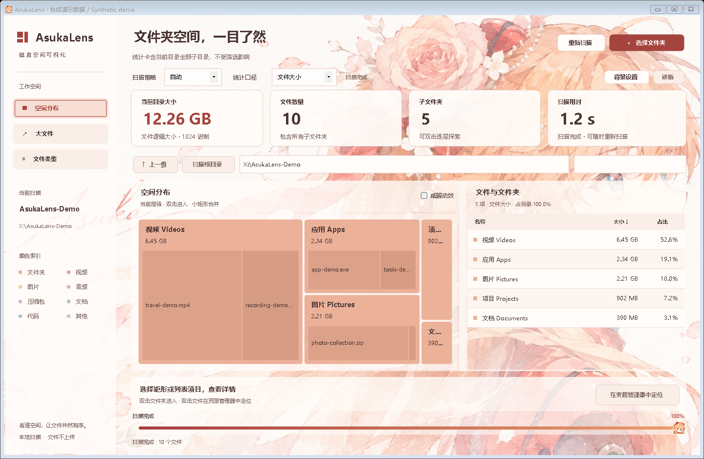

# AsukaLens

**See where your disk space goes.** A local disk-space visualizer for Windows.

[简体中文](README.md) · **English**

[Quick start](#quick-start) · [Run from source](#run-from-source) · [Development plan](docs/development-plan.md) · [Licensing and credits](NOTICE.md)

> [AsukaLens v1.5.0 is available](https://github.com/M66Y/Hard-Drive-Space-Visualization/releases/tag/v1.5.0) as a portable package, installer and source archives. Clean Windows 10/11 environments have not been validated. Windows 10 VM tests covered an earlier candidate; the final assets were not retested in that VM. See the [acceptance record](docs/release-readiness.md).



*Screenshot of the real window with synthetic demo data. Names, sizes and elapsed time are examples, not benchmark results. Background and avatar: AI-generated by M66Y.*

[View Releases](https://github.com/M66Y/Hard-Drive-Space-Visualization/releases) · [Detailed guide in Chinese](使用说明.txt)

See the [release-readiness checklist](docs/release-readiness.md) (Chinese) for current evidence and remaining acceptance work.

## Requirements

| Item | Current requirement |
| --- | --- |
| Tested systems | Final assets were tested on a Windows 11 x64 development host; an earlier candidate was tested in a Windows 10 22H2 x64 VM. Clean-system acceptance remains pending |
| Build from source | .NET 10 SDK **10.0.403 or a later patch in the same 10.0.4xx band**, constrained by `global.json` |
| Run the current development build | .NET 10 **Windows Desktop Runtime**; included in the Windows .NET SDK installer |
| Permissions and data | Uses your current account permissions; scans the selected folder without modifying it; settings and diagnostics stay local |
| Interface language | Simplified Chinese; this English README does not imply an English application UI |

Get the SDK or runtime from [Microsoft](https://dotnet.microsoft.com/en-us/download/dotnet/10.0). Other Windows versions and architectures have not been individually validated. The [framework compatibility list](https://learn.microsoft.com/en-us/dotnet/core/install/windows) is not the application's tested-system list.

## Features

| Feature | What it does |
| --- | --- |
| Choose a scan folder | Folder picker, drag-and-drop, or a startup path argument |
| Space treemap | See size by area; double-click folders to explore deeper |
| File list | Names, sizes and details; search, sort and 1,000-item pages |
| Largest files | The largest 500 matching files within the current folder and its descendants |
| File types | Totals by extension; double-click a type to filter its files |
| File helpers | Locate items in Explorer and copy paths; no deletion or moving |
| Two size metrics | Logical length or allocated file data; hard-link deduplication and explicit unknown allocation |

Also includes Automatic / Low-impact / High-speed strategies, live partial previews, cancellation and result recovery, NTFS journal-assisted refresh, local background cropping and accent colors, and [local diagnostics and problem notes](docs/diagnostics.md) (Chinese).

## Quick start

**New in the current development build: [disk activity panel](docs/disk-activity.md)** (Chinese guide). Expand it above scan progress to view the physical disk's last 60 seconds, activity, read/write throughput and response time. It follows the scan folder or a manually selected disk, pauses when collapsed or minimized, and keeps samples only in memory. Metrics cover the whole disk, including other processes. The published v1.5.0 assets do not include it.

1. Build and launch as below. Click **选择文件夹** (Choose folder), or drag a folder into the window.
2. Watch the stage and progress at the bottom. Browse discovered folders or cancel; live previews are marked as incomplete statistics.
3. Switch between **空间分布 / 大文件 / 文件类型** (Treemap / Largest files / File types), then search or sort.
4. Use **统计口径** (Size metric) to switch between logical size and allocated space. Select an item for details; double-click a file or use the locate button to open Explorer.
5. Press **F5** after files change; **Ctrl+F5** forces a complete scan.

| Shortcut | Action |
| --- | --- |
| Ctrl+O / Ctrl+F | Choose folder / Search the current view |
| Enter in the list | Open the selected folder or locate its file |
| Alt+↑ / Esc | Go to parent / Clear search |
| F5 / Ctrl+F5 | Rescan / Force a full scan |

**Reading results:** Cards include the current folder and all descendants, regardless of search, type filters or pagination. The search box indicates its scope. Percentages use the unfiltered current folder as their denominator. Largest files are limited to 500 entries; the treemap shows up to 240 main blocks and aggregates the remainder.

Progress estimates processed versus discovered directory tasks for the current stage. It can decrease when more directories appear; it is not a byte or time estimate. Previews update about every 0.5 seconds and include the first 1,000 discovered entries. Skipped entries, unknown allocation or unread directories produce **结果不完整** (Incomplete result). **查看未读取项** (View unread items) covers the entire scan. Cancellation or failure explicitly identifies retained previous results.

**Size limits:** Logical size counts each path. Allocated size deduplicates hard links within the scan scope; unknown allocation is not treated as known zero. Directory records, alternate data streams and other filesystem overhead are not fully included. **Allocated size is not the space freed by deleting a path.**

## Run from source

Install the required SDK, then get the source and open its root directory:

```powershell
git clone https://github.com/M66Y/Hard-Drive-Space-Visualization.git
cd Hard-Drive-Space-Visualization
.\run.ps1
```

You can also double-click [run.cmd](run.cmd). It builds the current source before launching `bin/Release/net10.0-windows/DiskAtlas.exe`. Build failures and an already-running development app produce a message. Opening an existing EXE directly does not update it. The title keeps the product name; **诊断 → 开发记录说明** (Diagnostics → Development records) shows the version and build identifier.

```powershell
# Build only; no package
.\run.ps1 -BuildOnly

# Build without the launch script
dotnet build DiskAtlas.csproj --configuration Release -p:TargetPlatformDisplayName=Windows -p:NuGetAudit=false

# Optional initial scan folder
dotnet run --project DiskAtlas.csproj -- "X:\ExampleFolder"
```

Normal builds use local SDK reference packs; `NuGet.Config` has no external feeds. Building from source is not installing a release. The root `build.ps1` is a legacy packaging entry. The new self-contained installer and snapshot scripts are documented in the [release guide](docs/releasing.md) (Chinese); use them only in an explicitly authorized packaging task. See [developer checks](docs/testing.md) (Chinese).

## Backgrounds and privacy

**背景设置** (Background settings) supports local PNG / JPEG / BMP images, zoom, focus and automatic or manual accent colors. Apply saves the changes; restoring the default does not delete the original image. Input is limited to 24 MiB and 40 million pixels; the saved copy has a maximum dimension of 2,048 pixels.

The application does not automatically upload files, paths, images or logs. Minimal local runtime diagnostics are on by default and can be disabled; runtime segments are capped at 8 MiB and 14 days. Problem notes are entered explicitly by the user. Runtime export requires selection and preview, and excludes problem notes. See [diagnostic storage and cleanup](docs/diagnostics.md) (Chinese).

## Planned work and limits

- **Future release acceptance:** v1.5.0 is published. Later versions still need a new freeze, packages and acceptance; existing clean-environment gaps remain recorded. See the [release guide](docs/releasing.md) (Chinese).
- **After the initial version (P2):** High-speed mode is not consistently faster than Automatic. Nonblocking restructuring and additional visual polish are deferred to the same stage.
- **Current limits:** Automatic chooses concurrency by device, without load adaptation. If the change journal is unavailable, refresh still verifies metadata for all directories and files and may not be much faster. The cache exists only within the current process.

See [project status](docs/project-status.md) and [development priorities](docs/development-plan.md) for evidence and sequencing (Chinese).

## Project layout

```text
AsukaLens/
├─ DiskAtlas.csproj           Windows Forms application
├─ Program.cs / MainForm.cs   Startup and main window
├─ Core.cs / ViewQuery.cs     Scan, data model and queries
├─ ScanCoordinator.cs        Refresh and cache coordination
├─ src/Diagnostics/          Local diagnostics and problem notes
├─ src/Scanning/             File-read concurrency budget
├─ src/Monitoring/           Physical disk sampling and activity panel
├─ assets/                   Default theme, icons and provenance
├─ tests/                    Functional/UI checks and synthetic preview
├─ docs/                     Developer docs, delivery plan and preview
├─ scripts/                  Assets, release/ snapshots and acceptance/ offline checks
├─ iterations/               Selected evidence and recovery patches
├─ run.cmd / run.ps1          Build and launch current source
├─ build.ps1                 Existing portable packaging script
├─ README.md / README.en.md   Chinese and English user guides
└─ LICENSE / NOTICE.md       Noncommercial licenses and attribution
```

## Licensing and credits

**AsukaLens — M66Y**. Code uses [PolyForm Noncommercial 1.0.0](LICENSE); documentation and artwork use [CC BY-NC 4.0](licenses/CC-BY-NC-4.0.txt). This is a source-available, noncommercial project, not OSI-approved open source. See [NOTICE.md](NOTICE.md) for scope and attribution, and the [asset inventory](assets/README.md) for generation provenance and third-party rights boundaries.
