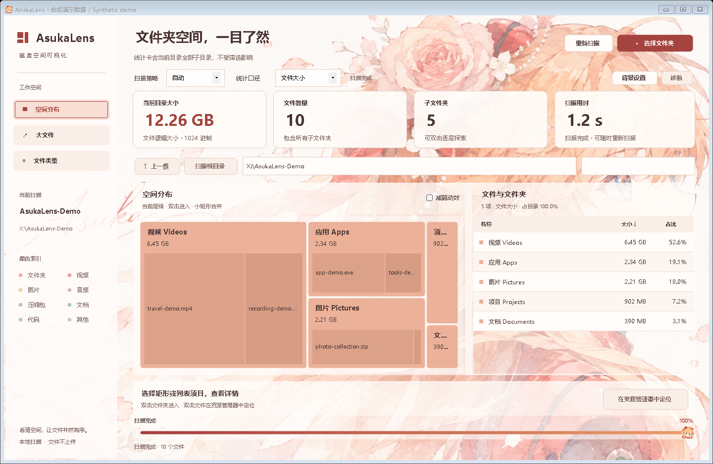

# AsukaLens

**看清空间，让文件井然有序。** Windows 本地磁盘空间可视化工具。

**简体中文** · [English](README.en.md)

[快速开始](#快速开始) · [从源码运行](#从源码运行) · [开发计划](docs/development-plan.md) · [许可与署名](NOTICE.md)

> **开发预览 · v1.4.2** — 源码包含后续迭代，旧 `软件/` 目录和 ZIP 不含最新功能。尚未公开正式 Release 或安装包；请从源码启动当前版本。



*真实主窗的合成数据预览。图中名称、大小和用时均为示例，不代表实测速度；背景与头像由 M66Y 使用 AI 工具生成。*

[查看 Release 页面](https://github.com/M66Y/Hard-Drive-Space-Visualization/releases)（当前无正式下载） · [详细使用说明](使用说明.txt)

## 适用环境

| 项目 | 当前要求 |
| --- | --- |
| 已验证系统 | Windows 11 x64；WinForms 桌面应用，无网页服务 |
| 从源码构建 | .NET 10 SDK **10.0.403 或同一 10.0.4xx 系列的后续补丁**，由 `global.json` 约束 |
| 运行当前开发构建 | .NET 10 **Windows Desktop Runtime**；.NET SDK 的 Windows 安装包已包含该运行时 |
| 权限与数据 | 使用当前账户权限，只读扫描目标目录；设置和诊断留在本机 |
| 界面语言 | 简体中文；英文 README 不代表应用已支持英文界面 |

SDK 和运行时从[微软官方下载页](https://dotnet.microsoft.com/en-us/download/dotnet/10.0)获取。其他 Windows 版本与架构尚未逐一验收；[框架兼容范围](https://learn.microsoft.com/en-us/dotnet/core/install/windows)不等于本软件的已测试范围。

## 功能

| 功能 | 可以做什么 |
| --- | --- |
| 选择扫描目录 | 选择文件夹、拖入目录或通过启动参数指定目录 |
| 空间分布图 | 通过面积查看占用来源，双击文件夹逐层进入 |
| 文件列表 | 查看名称、大小和详情，搜索、排序；每页 1,000 项 |
| 大文件视图 | 在当前目录及子目录中查找最大的 500 个匹配文件 |
| 文件类型统计 | 按扩展名汇总，双击类型筛选文件 |
| 文件操作辅助 | 在资源管理器中定位、复制完整路径；不删除或移动文件 |
| 两种大小口径 | 切换逻辑大小与实际分配空间；处理硬链接去重和未知占用 |

另有自动 / 低占用 / 高速三种策略、边扫边显示、取消与结果恢复、NTFS 日志增量刷新、本地背景裁切与强调色适配，以及[本地诊断和问题记录](docs/diagnostics.md)。

## 快速开始

1. 按下节构建并启动，点击 **选择文件夹**，或把目录拖入窗口。
2. 扫描时查看底部阶段和进度，可进入已发现目录或取消；预览标记为非最终统计。
3. 在 **空间分布 / 大文件 / 文件类型** 间切换，用搜索与排序找出占用来源。
4. 用 **统计口径** 切换“文件大小 / 实际占用”，选中项目查看详情，双击文件或点击定位按钮打开资源管理器。
5. 文件变化后按 **F5** 刷新；**Ctrl+F5** 强制完整扫描。

| 快捷键 | 操作 |
| --- | --- |
| Ctrl+O / Ctrl+F | 选择目录 / 搜索当前视图 |
| Enter（列表中） | 进入所选文件夹或定位文件 |
| Alt+↑ / Esc | 返回上一级 / 清空搜索 |
| F5 / Ctrl+F5 | 重新扫描 / 强制完整扫描 |

**读懂结果：** 统计卡含当前目录及全部子目录，不随搜索、类型筛选或分页改变。搜索框说明当前搜索范围；列表占比的分母为当前目录未筛选大小。大文件最多列出 500 项，图表最多单列 240 个主要区块，其余聚合展示。

进度百分比是当前阶段“已处理 / 已发现目录任务”的估算，发现新目录时可能下降，不是已读字节或剩余时间。预览约每 0.5 秒更新，最多先发现的 1,000 项。跳过项、未知占用或目录未读全会显示 **结果不完整**；底部“查看未读取项”覆盖整次扫描。取消或失败时明确说明是否保留了旧结果。

**大小边界：** 文件大小按路径计数；实际占用按扫描范围内的硬链接去重，未知部分不当作已知零。不包含目录记录、备用数据流等全部开销，**不等于删除后释放的空间**。

## 从源码运行

安装上述 SDK 后，获取本仓库源码并打开项目根目录：

```powershell
git clone https://github.com/M66Y/Hard-Drive-Space-Visualization.git
cd Hard-Drive-Space-Visualization
.\run.ps1
```

也可双击根目录 [run.cmd](run.cmd)。入口先构建当前源码，再启动 `bin/Release/net10.0-windows/DiskAtlas.exe`；构建失败或当前开发版仍在运行时会提示。直接打开已有 EXE 不会更新源码。标题显示版本，“诊断 → 开发记录说明”可查看构建标识。

```powershell
# 普通构建，不打包
.\run.ps1 -BuildOnly

# 不使用启动脚本时的构建命令
dotnet build DiskAtlas.csproj --configuration Release -p:TargetPlatformDisplayName=Windows -p:NuGetAudit=false

# 可选：启动时指定你要扫描的目录
dotnet run --project DiskAtlas.csproj -- "X:\ExampleFolder"
```

普通构建使用本机 SDK 引用包，`NuGet.Config` 不启用外部包源。源码运行不是安装发行版；根目录 `build.ps1` 是旧打包入口；新的自包含安装器与快照脚本见[发布说明](docs/releasing.md)，仅在明确授权的打包任务中使用。检查与基准命令见[开发验证](docs/testing.md)。

## 背景与隐私

“背景设置”支持本地 PNG / JPEG / BMP、缩放、焦点、自动或手动强调色；点击应用才保存，恢复默认不会删除原图。图片上限 24 MiB、4,000 万像素，软件副本最长边 2,048 像素。

软件不自动上传文件、路径、图片或日志。最小本地运行诊断默认开启、可关闭，运行分段最多 8 MiB / 14 天；问题记录由用户主动填写。导出运行诊断前须选择并预览，问题记录不混入导出。数据位置与清理边界见[诊断说明](docs/diagnostics.md)。

## 待优化与开发

- **初版交付准备**：自包含便携版、当前用户安装器及两种源码包的脚本和本机验收已实现；正式发布仍待干净 Windows 环境与远程草稿验收，见[发布说明](docs/releasing.md)。
- **初版后处理（P2）**：高速模式尚不能稳定快于自动，非阻塞结构整理与额外视觉打磨同级延期。
- **现有限制**：自动策略按设备选择并发，未实现负载自适应；变化日志不可用时仍核验所有目录与文件元信息，刷新不保证大幅提速；缓存只在本次运行内有效。

当前实现与验证范围见[项目现状](docs/project-status.md)，后续顺序见[开发计划](docs/development-plan.md)。

## 项目结构

```text
AsukaLens/
├─ DiskAtlas.csproj           Windows Forms 应用
├─ Program.cs / MainForm.cs   启动与主窗
├─ Core.cs / ViewQuery.cs     扫描、数据模型与查询
├─ ScanCoordinator.cs        刷新协调与缓存复用
├─ src/Diagnostics/          本地诊断与问题记录
├─ src/Scanning/             文件读取并发预算
├─ assets/                   默认主题、图标与来源说明
├─ tests/                    功能、UI 检查与合成预览
├─ docs/                     开发说明、交付方案与界面预览
├─ scripts/                  资源维护、release/ 快照和 acceptance/ 离线验收
├─ iterations/               精简迭代证据与恢复补丁
├─ run.cmd / run.ps1          当前源码构建与启动
├─ build.ps1                 现有便携打包脚本
├─ README.md / README.en.md   中英文用户入口
└─ LICENSE / NOTICE.md       非商业许可与署名
```

## 许可与署名

**AsukaLens — M66Y**。代码使用 [PolyForm Noncommercial 1.0.0](LICENSE)，文档与图片使用 [CC BY-NC 4.0](licenses/CC-BY-NC-4.0.txt)。这是源码可用的非商业项目，不宣称 OSI 开源许可。许可范围、署名与第三方权利边界见 [NOTICE.md](NOTICE.md)，默认图片的生成来源见[素材说明](assets/README.md)。
