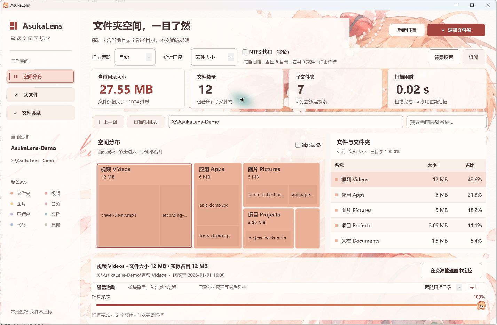

# C29：第一阶段视觉精修

2026-11-13，代码基线 `adfbd71d9723f0295cc286c29e68ff717a0699ac`。用户明确要求第一阶段在 4 小时内完成，并在真实 A/B 候选中选择 B 的轻透背景。实现及本机验收完成，阶段效果等待用户审阅；没有自动进入第二阶段，没有打包或 Release。

## 结果与取舍

- 保留角色背景、暖红浅色与现有分区。文字承载区用较稳定的浅底，列表行和空白用同一实体底色；卡片与非数据区保留轻透纹理。用户没有新增背景强度或密度设置。
- 正文／说明／控件采用 10.5／9.5／10 pt 语义尺寸，统一按钮主次、按压、禁用、焦点和导航选择标记。监测面板仅同步字号，采样与历史逻辑未变。
- Treemap 提高父子文字层级、收敛子块阴影与内侧选择轮廓。窄块不挤标签，大小和单位不能完整显示时一并隐藏，可通过原有 Tooltip／列表查看；面积、命中、动效与缓存上限保持原行为。
- 实际 150% 最小窗口发现并修正行／表头／列最小宽度未缩放、单列面板按自动首选宽度溢出，以及统计值单位省略。表格行高为 44 逻辑像素（本机 144 DPI 为 66 实际像素），小窗口接受少显示几行；统计数值在可用空间内有界适配字号，普通正文不被压小。

## 真实画面

以下均为真实 MainForm 使用原普通扫描流程读取自建普通文件目录的原生截图，目录显示为公开别名，内部路径与结果树保留真实夹具路径。数据为合成样本；画面里的扫描时间不是性能基准。预览未加载诊断服务，所以诊断按钮禁用，正式程序诊断行为未改。图像未做 AI 编辑。

最终 B 版（补齐 DPI 和小窗口问题后）：

对照材料：[改动前](preview-before.jpg)、[初步A候选](preview-a.jpg)、[初步B候选](preview-b.jpg)。A/B 使用同一合成结构、字体和布局比较背景；它们早于随后发现的 DPI／小窗口补齐，不能把候选图当最终完成画面。

## 验证

应用与测试构建均零警告。UI 回归 144／96 两档通过，背景各 7 组、表面／排版各 234 项、磁盘活动面板各 28 项与主窗各 58 项通过。字段见 [checks.json](checks.json)。程序位图用于底色、合成对比和几何断言，实际截图及窗口观察单独进行。

新增检查验证黑／白／棋盘背景下的数据底板与文字对比、原生输入字体容纳、最小窗口列边界，以及数值／单位／未知后缀适配。实际 144 DPI 常用和最小窗口、Ctrl+F 可见焦点、背景设置 Escape 取消已观察。预览关闭带自有模态窗口时先退出弹窗，再关闭主窗，针对性复验退出 0 且夹具清理。

初次 sandbox 预览在隔离桌面不可见，随后使用可见桌面预览，前者经 30 分钟守卫正常退出并清理。曾在桌面工具取消定位失败后关闭仍持有弹窗的预览，工具返回失败但夹具已清理；只修预览驱动关闭次序并复验，没有据此认定生产背景功能失败。预览错误仅输出固定阶段／类别／HRESULT，原始消息和路径不归档。

未实测 125%、真实跨屏、全部参考分辨率组合或本轮 Windows 10 新画面。96 DPI 虚拟化进程不能代替这些环境。没有大目录帧率或物理 I/O 性能结论。扫描、统计、搜索、定位和取消实现未在本轮重构，七项保留功能继续由既有流程回归覆盖。

## 复验与恢复

普通构建／测试命令见 [AGENTS.md](../../AGENTS.md)。新检查是 `--visual-surface-tests [--dpi-96]`。测试 apphost 的 `--stage-one-preview a|b [--minimum] [--dpi-96]` 保持真实窗口显示，使用隔离配置及小于 64 MiB 的自有夹具；保持 stdin 的会话中精确输入 `close` 可正常退出，EOF 仅停止监听。`baseline` 需预先准备 `artifacts/ui-stage1/baseline/DiskAtlas.dll`；本轮保留的是开始时旧正常开发输出，其哈希仅用于溯源，不当作冻结提交证明。

`files.json` 记录版本化索引字节哈希及媒体哈希；`changes.patch` 基于上述提交，仅含必要源码与文档，实际恢复后逐文件核对。临时旧构建／两处测试构建及未保留截图按已核对的项目子目录清理；自有夹具均正常退出后清理，不删除历史发行快照、用户配置或旧研究样本。保留的原生图与源码补丁是本阶段关键证据。

本阶段开发完成不等于用户已认可最终效果。下一步先听用户评价；进入第二阶段之前仍须先审具体交互方案。
