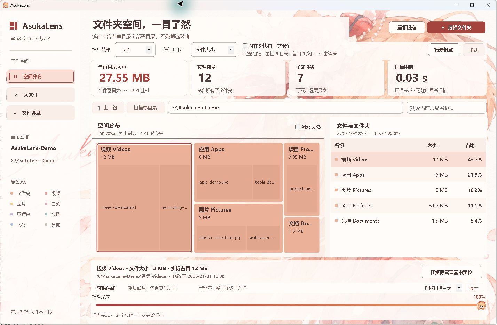
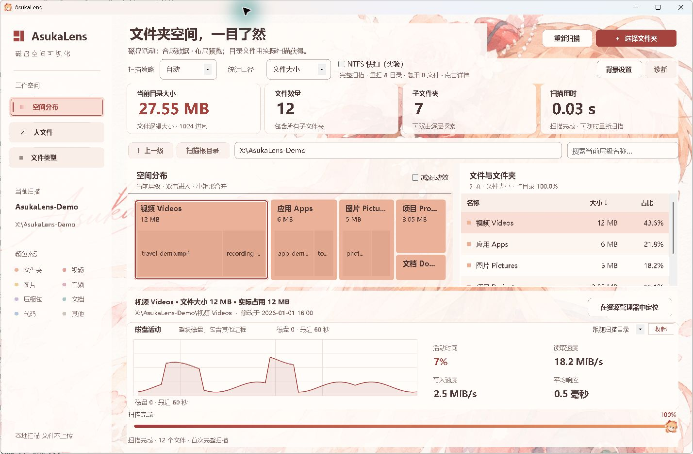

# C30：第一阶段比例修正

接续说明：下述底部候选已向用户展示；用户随后要求移入侧栏，并确认“迷你卡片＋详情弹层，默认关闭”。当前正在实施侧栏版，尚未验收；本目录后续会补最终证据，不能把现有候选图或旧恢复补丁当作侧栏实现。

2026-11-13，基线 `9ac1f0b30f31a4f00a4f55048409b1999cabbaf0`。用户复审 C29 后认为上方固定区偏高、磁盘活动收起偏厚而展开偏小，明确选择“整体收紧留白，保留字号与信息”和“底部保留一行摘要，展开增大曲线、右侧指标 2×2”。本轮是原第一阶段内的修正，仍由用户评价最终观感，不进入第二阶段；没有打包或 Release。

## 实现与取舍

| 区域 | C29 | 本轮（DIP） |
| --- | --- | --- |
| 标题、设置、统计卡、路径四行 | 85 / 60 / 124 / 62 | 72 / 52 / 112 / 52 |
| 图表／列表标题 | 70 | 60 |
| 详情行 | 82 | 72 |
| 磁盘活动收起 | 32 | 30，去掉包围框，保留分隔线与单行入口 |
| 磁盘活动展开 | 110，曲线固定 47 高 | 112–180 随可用高度变化；常用窗口曲线 116 高 |

上方四行合计减少 43 DIP，加上标题、详情、顶部和收起行的调整，收起时分析内容约多 69 DIP。统计卡外部间距 14→8，卡内 18 DIP 和普通文字字号保留；数值继续按实际宽高有界适配。常用展开时左侧为加大的曲线、右侧 2×2 指标；较矮窗口改为单排四指标，避免垂直重叠。

面板按已缩放的固定行和实际分页高度预留分析空间；分页出现／消失会重新计算。大小变化只调整几何，不重建采样源或清空历史。最小窗口展开且分页时，112 DIP 的监测最低高度仍可能让列表只显示部分一行；保留字号、分页和控件，不自动收起面板。收起或扩大窗口可查看更多。这不是新增密度模式，也未宣称所有小屏都已解决。

## 真实画面

以下是 144 DPI 下的原生桌面截图，没有 AI 编辑。预览使用真实 MainForm、原 Coordinator／普通扫描器读取自有普通文件夹具，内部结果树和路径保持真实，仅界面前缀使用公开别名。扫描时间只是演示数据，不是性能基准。

磁盘活动使用完全替换的合成发现／映射／采样源，按秒更新并预填 60 点布局曲线，副标题明确标记“合成数据 · 布局预览”。它不访问真实 PDH，也不是本机磁盘性能证明；收起不创建采样工作者。预览不加载诊断服务，因此该按钮禁用，生产功能不变。

[最小窗口展开](minimum-expanded.jpg)；上一版画面及背景候选留在 [C29](../2026-11-13-29-visual-polish/README.md)。本轮保留 B 轻透方向，没有重复要求用户选择背景。

## 验证与健壮性

应用／测试零警告构建。真实桌面上的默认 144 DPI 与虚拟化 96 DPI：UI 回归通过，表面／字体各 458 项、磁盘活动面板各 50 项、主窗各 77 项通过。实际常用收起／展开、最小窗口展开、Ctrl+F 焦点已观察，预览均正常退出并核归属清理。详见 [checks.json](checks.json)。

- 卡片测试使用绘制路径实际的标题／数值／说明矩形，检查字体容纳、单位完整、边界和不重叠；两种宽度／高度的监测几何验证曲线与指标。
- 最小窗口加分页验证保留表头、结果可视区域、分页控件和监测下限，单页另核完整首行；不把部分行说成完整首行。
- 缩放准备完成前不调整行高；尺寸变化不自振，退出后旧 UI 回调仍由既有版本与生命周期保护。收起／最小化／切盘／恢复的来源释放和新基线继续受测。
- 初次 96 DPI 原生下拉框因首选高度超出摘要行，改为按真实 `PreferredHeight` 居中；说明文字测得 160px、原区域 154px，收紧外部卡间距后保留原字号和内距通过。
- 一次生命周期测试在新源创建后过早接受旧显示样本，改为等待当前代际的样本实际显示；生产采样语义未因此改动。
- sandbox 图形桌面出现 GDI+ 绘制错误，真实桌面重新验证通过；临时布局实验和诊断输出已移除，没有全局吞异常或改扫描启动逻辑。两份异常测试遗留夹具在核对临时根、nonce、固定目录／文件及零字节内容后清理，没有残留测试／预览进程或夹具。

程序位图是自动断言，桌面截图与人工观感分开。未实测 125%、动态跨屏、系统文字缩放、本轮新版 Windows 10 或全部参考分辨率组合；96 DPI 虚拟化不替代这些环境。未重构扫描／统计／搜索／定位／取消，不追加个人目录、raw／VSS／VHD 操作或性能基准。背景保存流程不变，未将 C29 的背景验证重复记为本轮运行。

## 复验与恢复

按 [AGENTS.md](../../AGENTS.md) 构建应用和测试，运行 `--ui-regression`、`--visual-surface-tests`、`--disk-activity-panel-tests`、`--disk-activity-mainform-tests`，各加 `--dpi-96` 复验另一档。需要原生桌面绘制的检查应在可用桌面运行。

测试 apphost 支持 `--stage-one-preview a|b [--minimum] [--dpi-96] [--expanded]`。默认收起；`baseline` 需自备旧开发程序集，禁止展开，以免误接旧实现的真实采样。保持 stdin 的终端会话中输入精确 `close` 可退出；EOF 只结束监听。关闭自有模态窗口、扫描取消和夹具核归属清理沿用 C29 守卫。

`changes.patch` 只包含本轮必要源码、规则和文档，基于上述提交；恢复目录中实际应用并逐文件核对 `files.json` 的版本化索引字节哈希。媒体单独记录哈希，不递归包含旧归档或自身。C29 开始时的普通开发 DLL 临时副本哈希为 `6d276c347cae7464afa99f235c4c9b23c522a24318d2a941f94ceb35f43318a8`，仅作开发输出溯源，不是冻结提交证明。

收尾清理本轮 baseline／harness／临时截图与恢复目录，保留正常开发输出及本目录精选证据，不动历史发行快照、个人配置或旧研究样本。正式 v1.5.0 资产保持原快照。本轮结果已展示并询问用户观感，未获得下一阶段实施授权。
